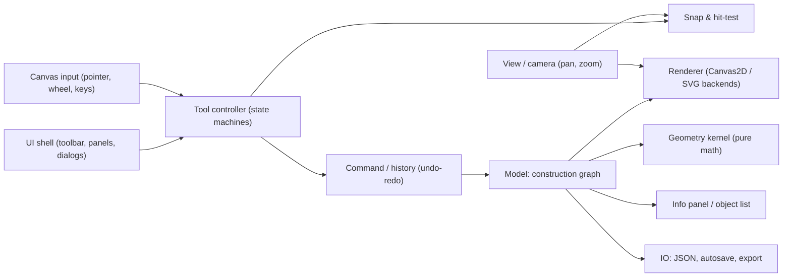

# Euclid Sketch — Design Document

A single-page, dependency-free web application for drawing dynamic 2D Euclidean diagrams.

| | |
|---|---|
| Status | Draft v1 — design only, no implementation |
| Target | Modern evergreen desktop browsers (Chrome, Edge, Firefox, Safari — last 2 versions); touch/pen supported as secondary |
| Delivery | Static files opened directly via `file://` — no web server, no build step, no external dependencies |

---

## 1. Goals and non-goals

### 1.1 Goals
1. Construct the primitives **point, line, ray, segment, angle, circle, polygon** (with interior fill for rectangles), with labels that follow strict mathematical typesetting conventions.
2. **Dynamic geometry**: every object stores *how* it was constructed. Dragging a free point recomputes everything that depends on it (a construction graph, like GeoGebra or Cabri).
3. A complete set of construction tools (altitude, parallel, midpoint, polar/pole, Apollonius-style tangent circles, etc.).
4. Snapping to points, intersections, and objects while building.
5. Measurement relative to a user-chosen **reference segment** with a user-defined length.
6. A properties **info panel** for the current selection.
7. Clean, print-quality rendering, plus PNG/SVG export and JSON save/load.

### 1.2 Non-goals (v1)
- 3D, conics other than circles, function plotting, algebra/CAS.
- Collaboration or cloud storage.
- Proof checking or automated theorem discovery.

### 1.3 Hard constraints that follow from `file://`
| Constraint | Consequence for the design |
|---|---|
| ES modules (`<script type="module" src>`) are blocked by CORS on `file://` in Chromium | Use **classic scripts** with one global namespace `window.Geo`, loaded in dependency order |
| `fetch()` / XHR of local files is blocked | No runtime-loaded JSON, fonts, or icon files. Icons are an **inline SVG sprite** in `index.html`; config is JS |
| Web Workers from `file://` are blocked in Chromium | Everything runs on the main thread (the workload is small) |
| No server-side persistence | Use `localStorage` autosave (works on `file://` in Chrome/Firefox; Safari behaves per-file), plus explicit **Save** (Blob + `<a download>`) and **Open** (`<input type="file">` + `FileReader`) |
| No web fonts | System font stacks only (see §10.3) |

---

## 2. High-level architecture



**Principles**
- **Model is the single source of truth.** The UI never stores geometric state.
- **The kernel is pure.** Functions take numbers and return numbers or `null` (undefined). There is no DOM access, so it can be unit-tested in isolation.
- **Recompute, then render.** Any change marks the affected subgraph dirty. One `requestAnimationFrame` pass recomputes in topological order and redraws.
- **The renderer is backend-agnostic.** Drawing goes through a small `Painter` interface, implemented once for Canvas2D (screen and PNG) and once for an SVG string writer (SVG export).

### 2.1 File layout

```
geometry/
├── index.html            # markup, inline SVG icon sprite, <script> tags in order
├── css/
│   └── app.css           # all styles, design tokens as CSS custom properties
├── js/
│   ├── geo.js            # creates window.Geo namespace, constants, utils
│   ├── kernel/
│   │   ├── vec.js        # 2D vector ops
│   │   ├── primitives.js # line/circle representations, distances, projections
│   │   ├── intersect.js  # line-line, line-circle, circle-circle
│   │   ├── circles.js    # circumcircle, tangent-circle solvers (LLL, PPL, PLL)
│   │   └── polar.js      # pole/polar
│   ├── model/
│   │   ├── objects.js    # object type registry, definitions ("defs")
│   │   ├── graph.js      # dependency graph, topo sort, recompute, delete cascade
│   │   ├── labels.js     # label grammars, validation, auto-naming, layout
│   │   └── measure.js    # reference segment, unit conversion, measurement objects
│   ├── view/
│   │   ├── camera.js     # world<->screen transforms, pan/zoom
│   │   ├── painter-canvas.js
│   │   ├── painter-svg.js
│   │   ├── render.js     # draws model + previews + overlays via Painter
│   │   ├── hittest.js
│   │   └── snap.js
│   ├── tools/
│   │   ├── tool-base.js  # step-machine framework
│   │   ├── select.js, point.js, line.js, circle.js, angle.js,
│   │   ├── construct.js  # altitude, parallel, midpoint, polar, pole, etc.
│   │   ├── convert.js, measure-tools.js
│   ├── ui/
│   │   ├── toolbar.js, infopanel.js, objectlist.js, dialogs.js,
│   │   ├── label-editor.js, greek-palette.js, toasts.js, statusbar.js
│   ├── history.js        # undo/redo
│   ├── io.js             # save/open/autosave/export
│   └── main.js           # bootstraps everything
└── tests/
    ├── tests.html        # open locally; runs kernel/model tests in-page
    └── *.test.js
```

All JS files use the pattern `(function (Geo) { ... })(window.Geo);` and register onto `Geo.kernel`, `Geo.model`, `Geo.view`, `Geo.tools`, and `Geo.ui`.

> A single-file distribution (`euclid.html` with everything inlined) can be produced later by a trivial concatenation script. This is optional and not required for v1.

---

## 3. Coordinate systems and view

- **World coordinates**: Cartesian, y-axis **up**, double precision. The origin is the canvas centre at first launch. One world unit equals 100 CSS px at 100 % zoom.
- **Screen coordinates**: CSS pixels, y down. The canvas backing store is scaled by `devicePixelRatio` for crisp lines.
- **Camera**: `{cx, cy, scale}`. `screen = ((x - cx)·scale + W/2, (cy - y)·scale + H/2)`.
- **Zoom**: mouse wheel or pinch, anchored at the cursor. Range 5 %–5000 %. Steps ×1.1 per wheel notch; trackpad pixel deltas are applied continuously.
- **Pan**: Space + drag, middle-mouse drag, two-finger drag, or the Pan tool (H).
- **Zoom to fit** (Shift+1) frames all visible finite objects.
- **Infinite objects** (lines, rays) are clipped to the viewport rectangle, expanded by 2 px, using Liang–Barsky. In SVG export they are clipped to the export rectangle.
- **Displayed coordinates** in the UI are shown in *reference units* (§7). If no reference is set, coordinates are hidden from the info panel and "— (set a reference)" is shown instead.

---

## 4. Data model

### 4.1 Object record

Every object is a plain JSON-serialisable record:

```js
{
  id: "o17",                 // stable unique id
  type: "point" | "line" | "circle" | "angle" | "polygon" | "measure",
  def: { kind: "...", ... }, // construction definition (parents by id + params)
  label: { text: "A_1", visible: true, dx: 8, dy: -10 },  // offset in screen px
  style: {
    color: "ink", width: 2, dash: "solid", size: 4.5, marks: 0,
    fill: "rgba(47,111,235,0.12)", fillEnabled: true // for polygons / closed regions
  },
  visible: true,
  aux: false,                // auxiliary/helper object (drawn lighter)
  group: null,               // e.g. id of a composite construction group
  // runtime only (not serialised):
  _geom: {...} | null,       // computed geometry; null => undefined
  _parents: [...], _children: [...]
}
```

**Lines, rays, and segments are one type, `line`, with an `extent` field.** This makes the convert tools (§6.10) trivial and keeps dependents valid.

```js
// type: "line"
extent: "line" | "ray" | "segment"
// The geometry always exposes: P0, P1 (anchor points), direction d, unit normal n, offset c (n·X = c)
// ray: origin = P0, through P1;  segment: [P0, P1]
```

### 4.2 Definitions (`def.kind`)

**Points**
| kind | parents / params | geometry |
|---|---|---|
| `free` | `x, y` | as given; draggable |
| `onLine` | `line, t` | point strictly constrained to a linear primitive (Tool 9) |
| `onObject` | `obj, t` | line: `P0 + t·(P1−P0)`; circle: `O + r(cos t, sin t)`; draggable along primitive (Tool 14) |
| `intersection` | `a, b, branch` | see §5.3; computed on carrier lines; `branch` selects which of up to 2 points |
| `midpoint` | `seg` (or `p, q`) | `(P0+P1)/2` |
| `center` | `circle` | `O` |
| `foot` | `point, line` | perpendicular projection |
| `pole` | `circle, line` | §5.6 |
| `offsetOnLine` | `line, point, length, sign` | `P + sign·L_world·û` (segment of given length) |
| `rectCorner` | `line, point, a, b, su, sv, corner` | corner point of constructed rectangle (§6.5) |
| `angleArm` | `line, vertex, deg, baseSign, rotSign` | helper point on the constructed arm |

**Lines (any extent)**
| kind | parents / params |
|---|---|
| `twoPoints` | `p, q` |
| `parallel` | `line, point` |
| `polar` | `circle, point` |
| `altitude` | `point, line` → segment from point to foot (anchors = point, foot point) |

**Circles**
| kind | parents / params |
|---|---|
| `threePoints` | `a, b, c` |
| `centerPoint` | `center, p` |
| `centerTangent` | `center, line` |
| `tangent3L` | `l1, l2, l3, branch` (branch = sign vector, §5.5) |
| `tangent2P1L` | `p, q, line, branch` |
| `tangent1P2L` | `p, l1, l2, branch` |

**Angles**
| kind | parents / params |
|---|---|
| `threePoints` | `a, vertex, b` (rays vertex→a, vertex→b) |
| `twoRays` | `r1, r2` (must share an origin point) |
| `fromLine` | `line, vertex, deg, baseSign, rotSign` (tool 6) |

Angle runtime geometry: `{V, u1, u2, sweep}`. `sweep` is the CCW angle from `u1` to `u2` in (0, 2π). The `reflex` style flag chooses between `sweep` and `2π − sweep`. By default the non-reflex angle is drawn.

**Polygons** (`type: "polygon"`)
| kind | parents / params | geometry |
|---|---|---|
| `rectangle` | `line, point, a, b, su, sv` (or vertices `[p0, p1, p2, p3]`) | `{ vertices: [P0, P1, P2, P3], area: a*b, perimeter: 2*(a+b) }` with customizable fill and boundary stroke |

**Measurements** (`type: "measure"`)
| kind | parents |
|---|---|
| `distPP` | `p, q` |
| `distPL` | `p, line` |
| `length` | `seg` |
| `angle` | `angle` |
| `circle` | `circle, what: "r" \| "d" \| "C" \| "A"` |
| `polygon` | `polygon, what: "A" \| "P"` (area, perimeter) |

### 4.3 Document

```js
{
  format: "euclid-sketch", version: 1,
  camera: {cx, cy, scale},
  reference: { seg: "o4", value: 5, unit: "cm" } | null,
  settings: { snap: true, grid: false, precision: 2, angleUnit: "deg" },
  objects: [ ...records in creation order (always a valid topological order) ]
}
```

### 4.4 Construction graph
- `_parents` are derived from `def` (every field that references an id). `_children` is the inverse index.
- **Recompute**: when objects change (for example, after a drag), the system collects their descendants and evaluates them in creation order, which is guaranteed topological because parents always exist before children. The cost is O(affected).
- **Undefined propagation**: if a kernel function returns `null` (parallel lines don't meet, a point at the circle centre has no polar, etc.), `_geom = null`. Children of an undefined object are also undefined. Undefined objects are not drawn and are shown in the object list with an "undefined" tag. They come back automatically when the configuration allows.
- **Delete**: deletes the object and all its descendants. If there are descendants, a confirm dialog lists the count ("Delete A and 6 dependent objects?").
- **Redefine is not in v1**, except for the convert tools, which only change `extent` or swap anchors.
- **Dedupe**: before any tool creates a point, it checks for an existing point whose geometry is within ε (1e-9 relative to the scene scale) *or* that has an identical definition. If one exists, the existing point is reused. This implements "unless already a point" for intersections and avoids duplicates in general.

### 4.5 Dragging semantics
| Grabbed object | Behaviour |
|---|---|
| free point | moves freely (snaps to grid if grid is on) |
| onLine / onObject point | the parameter `t` is updated to the projection of the cursor onto the parent (slides along line or circle) |
| line/circle whose defining points are all free | translates all of those free points together |
| polygon | grabbing the interior translates all its defining free vertices together |
| anything else (dependent) | not draggable; cursor `not-allowed`; the status bar says "B is dependent — drag its free parents" |

A whole drag is coalesced into a single undo step.

---

## 5. Geometry kernel

All functions are pure and return `null` when the result is undefined. `EPS = 1e-10` is the absolute tolerance on normalised quantities. Lines are internally `{P, d, n, c}` with `|n| = 1` and `n·X = c`.

### 5.1 Basics
- Line through P, Q: `d = Q−P`, `n = perp(d)/|d|`, `c = n·P`. Undefined if `|d| < EPS`.
- Signed distance from X to the line: `n·X − c`.
- Foot of perpendicular: `F = X − (n·X − c)·n`.
- Point on segment/ray test: parameter `t = (X−P0)·d/|d|²`. Segment: t ∈ [0, 1]. Ray: t ≥ 0.

### 5.2 Circumcircle (3 points)
`D = 2[ax(by−cy) + bx(cy−ay) + cx(ay−by)]`. If `|D| < EPS` (collinear), the result is undefined. The standard formula gives the centre; r = |O − A|.

### 5.3 Intersections
- **Line–line**: solve `n1·X = c1`, `n2·X = c2` by Cramer's rule. Parallel → `null` (or the lines are coincident → `null`).
- **Line–circle**: F = foot of O on the line, `δ = |O−F|`, `h = √(r² − δ²)`. Result: `F ± h·d̂`. `branch 0` is the `−` point and `branch 1` is the `+` point, ordered along `d`, which is stable while dragging.
- **Circle–circle**: `D = |O2−O1|`, `a = (D² + r1² − r2²)/(2D)`, `h = √(r1² − a²)`. Result: `M ± h·perp(ê)`. Branches are ordered by the side of the directed centre line (left = 0).
- Tangency (h ≈ 0) yields one point, and both branches coincide.
- **Carrier line intersections**: Intersections of linear primitives (lines, rays, segments) with each other or circles **always use the full extended carrier line**. Even if an intersection falls beyond the endpoints of a segment or origin of a ray, the intersection point is created and remains fully valid. When an intersection falls outside a finite segment or ray extent, subtle dashed extension guide lines (`style.extendTo`) are rendered from the primitive to the intersection point to maintain geometric visual clarity.

### 5.4 Pole and polar
Circle (O, r):
- **Polar of P**: the line `{X : (X−O)·(P−O) = r²}`, i.e. `n = (P−O)/|P−O|`, `c = n·O + r²/|P−O|`. Undefined if P = O.
- **Pole of line (n, c)**: `δ = c − n·O`. Pole = `O + (r²/δ)·n`. Undefined if `|δ| < EPS` (the line passes through the centre).

### 5.5 Tangent circles (Apollonius special cases)

Segments and rays always contribute their **carrier line**. If the tangency point falls outside the segment/ray extent, the circle is still valid, but the info panel notes "tangent to the extension of s".

**Center + point**: `r = |P − O|`. **Center + tangent line**: `r = |n·O − c|` (undefined if 0).

**LLL — tangent to 3 lines** (unified linear formulation). For signs σ = (σ1, σ2, σ3) ∈ {±1}³, solve the 3×3 linear system in (x, y, r):

```
σi·(ni·C − ci) = r,   i = 1..3
```

Keep solutions with r > EPS. σ and −σ give the same circle with opposite r, so fix σ1 = +1 and get 4 sign vectors, which produce **≤ 4 circles** (the incircle and 3 excircles). Singular systems are skipped, which automatically handles the cases: two parallel lines → 2 circles, three parallel or concurrent lines → 0. **Branch = sign vector**, which is perfectly stable under dragging.

**PPL — through P, Q and tangent to line L.** The centre lies on the perpendicular bisector: `C(s) = M + s·n̂`, where `M = (P+Q)/2`, `n̂ ⟂ PQ`, `h = |PQ|/2`. The signed distance to L is linear: `g(s) = g0 + g1·s`, with `g0 = n_L·M − c_L` and `g1 = n_L·n̂`. Since `|C−P|² = h² + s²`:

```
(1 − g1²)·s² − 2·g0·g1·s + (h² − g0²) = 0
```

- If `|1 − g1²| < EPS` (PQ ∥ L), the equation is linear: `s = (h² − g0²)/(2·g0·g1)`, giving 1 circle.
- Discriminant < 0 means P and Q are on opposite sides of L → 0 circles.
- P = Q → undefined.
- **Branch** = root index (smaller s / larger s). This is stable unless the roots cross, and they only cross at the degenerate point.

**PLL — through P and tangent to lines L1, L2.** Centres lie on an angle bisector: `n1·C − c1 = ±(n2·C − c2)`. That gives 2 bisectors, or 1 midline if L1 ∥ L2. For each bisector, parametrise `C(s) = B0 + s·ŵ`. The radius is `|a0 + a1·s|`, where `a0 = n1·B0 − c1` and `a1 = n1·ŵ`. Solve

```
(1 − a1²)·s² + 2(ŵ·(B0 − P) − a0·a1)·s + (|B0 − P|² − a0²) = 0
```

This gives **≤ 4 circles** (2 bisectors × 2 roots), and the parallel case gives ≤ 2. **Branch** = (bisector sign, root index).

**Solution choice during construction.** After the final pick, if more than one solution exists:
1. All candidates are drawn as dashed previews, and the one **closest to the cursor** (by distance to its circumference) is highlighted.
2. The user clicks to accept, or presses **1–4** or **Tab** to cycle and **Enter** to accept. **Esc** cancels.
3. If exactly one solution exists, it is created immediately. If there are none, a toast explains why (for example, "P and Q are on opposite sides of a — no tangent circle exists").

**Branch continuity.** When a free point is dragged, each circle keeps its stored branch. If that branch becomes non-existent, the circle becomes undefined rather than jumping to another solution. This matches the behaviour users expect in dynamic geometry.

### 5.6 Other constructions
- **Parallel through P**: `n` stays the same, `c = n·P`.
- **Segment of length L on a line from P**: `û = sign·d̂`, end = `P + L_world·û`, with `L_world = L · refWorld/refValue`.
- **Angle of θ from a line at V**: base direction `b̂ = baseSign·d̂`. Arm direction = `rot(b̂, rotSign·θ)`. A helper point is placed at `V + R·arm`, where R = 1.5 × the default angle-arm length in world units (the user can drag it later, which changes only its distance along the arm).
- **Rectangle**: see §6.5.

---

## 6. Tools

### 6.1 Tool framework (step machine)

Each tool is declared as data plus three callbacks:

```js
Geo.tools.register({
  id: "circle.ppl",
  name: "Circle: 2 points + tangent",
  icon: "i-circle-ppl", key: null, group: "circle",
  steps: [
    { accept: "point", prompt: "Select or place the first point" },
    { accept: "point", prompt: "Select or place the second point" },
    { accept: "linear", prompt: "Select a tangent line, ray, or segment" }
  ],
  preview(picks, cursor) { /* returns transient geometry for the renderer */ },
  solutions(picks) { /* optional: array of candidate geometries/branches */ },
  commit(picks, choice, params) { /* returns a list of new object records */ },
  params: null | (picks) => dialogSpec   // numeric-input tools open a dialog
});
```

**Accept filters**: `point`, `line` (extent line only), `linear` (line/ray/segment), `segment`, `ray`, `circle`, `angle`, `curve` (linear or circle), and `pointOn(objPick)` (a point that lies on a previously picked object).

**Generic behaviour**
- For `point` steps, a click on empty space creates a free point. A click near something snappable creates the snapped point (§8). These points are created *inside* the same undo step as the tool result.
- **Pre-selection**: if objects are selected when a tool is activated, they fill the steps in order. The tool then waits only for the missing picks, or commits immediately.
- **Esc** goes back one step (removing the most recent pick). A second Esc returns to Select.
- Each step shows its prompt in the **prompt chip** (top centre of the canvas) and in the status bar, e.g. `Circle · 2 points + tangent — step 3 of 3: select a tangent line`.
- Picked objects get a "picked" highlight (§10.6) until the tool completes.
- After commit, the tool stays active for repeated use (sticky tools). Select is V/Esc.

### 6.2 Tool catalogue

Shortcuts are single keys when the canvas has focus. **Bold** = group default.

| # | Tool | Key | Steps | Result |
|---|---|---|---|---|
| — | **Select / Move** | V | click, Shift+click, marquee drag | selection, drag |
| — | Pan | H | drag | camera |
| P1 | **Point** | P | click (snaps) | free / onObject / intersection point |
| P2 | Point on primitive (14) | Shift+P | click on any curve or primitive | `onObject` point — always snaps to the nearest curve (e.g. circle) |
| P3 | Intersection (10) | X | pick curve, pick curve — *or* click directly on a crossing | intersection points on carrier lines, deduped |
| P4 | Midpoint (7) | M | pick a segment — *or* 2 points | `midpoint` point |
| P5 | Circle center (13) | O | pick a circle | `center` point |
| P6 | Point on line (9) | — | pick linear object (line/ray/segment) | `onLine` point lying on the line, snapping to it |
| L1 | **Line** | L | point, point | line |
| L2 | Ray | R | origin point, through point | ray |
| L3 | Segment | S | point, point | segment |
| L4 | Parallel line (8) | ⇧L | linear, point (not on the line) | `parallel` line |
| L5 | Altitude (1) | T | point, linear | foot point + altitude segment |
| C1 | **Circle (smart)** | C | 3 picks among points/lines (any order) | inferred: PPP, PPL, PLL, LLL |
| C2 | Circle: center + point | ⇧C | center, point | `centerPoint` |
| C3 | Circle: center + tangent | — | center, linear | `centerTangent` |
| C4–C7 | Explicit variants: 3 points, 3 tangents, 2 points + tangent, 1 point + 2 tangents | — | as named | as named |
| A1 | **Angle** | A | point, vertex, point — *or* ray, ray (shared origin) | angle |
| A2 | Angle of given size (6) | ⇧A | linear, vertex point on it, dialog (degrees), then click side | 1 ray, 1 helper point, 1 angle |
| K1 | Segment of given length (4) | ⇧S | linear, point on it, dialog (length, requires reference) | endpoint + segment (blocks if no ref) |
| K2 | Rectangle (5) | ⇧R | linear, point on it, dialog (a, b, requires reference) | 4 points + filled polygon (blocks if no ref) |
| K3 | Polar (11) | — | circle, point | `polar` line |
| K4 | Pole (12) | — | circle, linear | `pole` point |
| V1 | Line ↔ Segment (2) | — | pick line or segment | toggles extent |
| V2 | Line ↔ Ray (3) | — | pick line or ray (choose origin end) | toggles extent |
| M0 | Set reference | — | pick segment (or 2 points), dialog | reference |
| M1 | **Distance / length** | D | 2 points, point + line, or one segment | measurement annotation (requires ref) |
| M2 | Angle measure | — | pick angle (or 3 points) | measurement annotation |
| M3 | Circle measure | — | pick circle, choose r/d/C/A | measurement annotation |
| — | Delete | Del/⌫ | — | deletes the selection (cascade confirm) |

### 6.3 Altitude (1)
- Picks a point X and a linear object ℓ. Creates the foot point F (`foot` def, auto-labelled `H`, `H_1`, … — the conventional letter for altitude feet) and a segment XF (`altitude` def, styled like a normal segment). It also creates a **right-angle mark** at F (an `angle` object with `marks: "right"`, no label) — this option is on by default and can be toggled in the tool's options strip.
- If F lies outside a segment/ray extent, a dashed **extension** of ℓ from its nearest end to F is drawn automatically (render-only decoration, `style.extendTo: F`). This is the standard textbook convention for an altitude falling outside a side.
- If X is on ℓ, the toast says "Point lies on the line — altitude is degenerate" and nothing is created.

### 6.4 Segment of given length (4)
1. **Reference check**: Strictly requires a reference segment. If no reference is set, the tool blocks and displays a dialog: *"Reference segment required. Please set a reference segment before constructing segments of a given length."* with actions **Pick reference…** (launches tool M0 and then resumes) and **Cancel**.
2. Pick a linear object ℓ, then a point P on ℓ. If the user clicks ℓ where no point exists, an `onLine` point is created.
3. A dialog asks for **Length** (number > 0, in reference units).
4. A preview shows the segment pointing toward whichever side of P the cursor is on. Clicking commits it, creating the end point (`offsetOnLine`) and a segment. For rays/segments, the endpoint may fall outside the extent; that is allowed, and the constructed segment lies on the carrier line.

### 6.5 Rectangle (5)
1. **Reference check**: Strictly requires a reference segment. If no reference is set, blocks with the same reference requirement dialog as tool (4).
2. Pick ℓ, then a point P on ℓ. A dialog asks for side **a** (along ℓ) and side **b** (perpendicular), both in reference units, with a "Square (b = a)" checkbox.
3. The preview follows the cursor quadrant relative to P. `su` is the sign along d̂ and `sv` is the sign along n̂.
4. Commit creates:
   - 4 corner points `P` (existing), `P + a·su·û`, `P + a·su·û + b·sv·v̂`, `P + b·sv·v̂` as `rectCorner` points, auto-labelled in the next free consecutive capital letters.
   - A `polygon` entity with vertices `[P0, P1, P2, P3]`, styled with perimeter stroke (2px solid) and a semi-transparent interior fill (`fill: rgba(47,111,235,0.12)`, toggleable and customizable in the style section).
   - Selecting any edge or the interior selects the rectangle, with corner points remaining independently selectable and snappable.

### 6.6 Angle of a given magnitude (6)
1. Pick ℓ and a vertex V on ℓ. A dialog asks for the **Angle** in degrees, 0 < θ < 360 (accepts `°`, and radians via a `rad` suffix, e.g. `pi/3 rad`).
2. The preview is driven by cursor position. The base ray is the half of ℓ on the cursor's side along ℓ (`baseSign`), and the rotation sense is the cursor's side of ℓ (`rotSign`). Both are shown live.
3. Commit creates a helper point on the arm, the arm ray V→helper, and an angle object between the base half-line and the arm. If ℓ has no anchor point on the base side, the angle's first ray is an implicit direction stored in the def, so no extra point is needed. The angle label is auto-assigned (α, β, …) and shown with its measure if "show measure" is on.

### 6.7 Midpoint (7)
Pick a segment, or two points. Creates a `midpoint` point (auto-label `M`, `M_1`, …). An option to also draw equal-length tick marks on both halves is **off** by default.

### 6.8 Parallel (8)
Pick a linear object, then a point. If the point is on the line, a toast says "Point lies on the line" and nothing is created. The new object has extent `line`. Its label is auto-assigned.

### 6.9 Point on a line (9)
1. Select the tool (or pick a linear object ℓ — line, ray, or segment).
2. Click anywhere along ℓ. The tool snaps strictly to ℓ and creates a point P with definition `onLine`.
3. The created point is constrained to ℓ: when dragged, it slides dynamically along the line (the internal parameter `t` tracks the projection of the cursor onto the line).
4. If other primitives intersect ℓ at or near the clicked location, the point snaps cleanly to their crossing.

### 6.10 Convert tools (2, 3)
- **Line ↔ Segment**: if the object has two anchor points (`twoPoints`, `altitude`), only `extent` changes. If it has no second anchor (`parallel`, `polar`), the tool asks the user to pick two points on it; existing points can be snapped to, or `onLine` points are created. The def then becomes `twoPoints`-on-carrier. Implementation: the object keeps its def and gains `clip: {p, q}` anchors, so the carrier stays dependent on the original construction.
- **Line ↔ Ray**: when converting line → ray, the user clicks near the end that should be the origin. The anchor nearest the click becomes `P0`, and anchors are swapped if needed. Ray → line simply changes `extent`.
- **Labels on conversion**: segment labels (expressions) and line/ray labels (single letters + optional subscripts) have different grammars. If the existing label is invalid for the new kind, it is kept *hidden* in `label.stash`, so converting back restores it. A toast says "Label hidden: 'x+1' is not a valid line label".
- **Dependents**: intersections with the converted object are preserved on the carrier line (never broken by converting extent).

### 6.11 Intersection (10)
- Mode A: pick two curves → create **all** intersection points (0–2), computed on their carrier lines, skipping ones that already exist (dedupe). Toast: "Created 1 point (1 already existed)".
- Mode B: click within 10 px of a visible crossing → create just that intersection on the carrier lines.
- **Carrier line extension**: Per user requirement, intersections of linear primitives (segments, rays, lines) with each other or circles always compute the intersection of the infinite carrier lines. If an intersection point falls outside the drawn extent of a segment or ray, the point is nonetheless created, and subtle dashed extension guide lines indicate the alignment.
- Also available implicitly: any point step snaps to carrier intersections (§8).

### 6.12 Polar (11), Pole (12), Center (13)
Straightforward picks, per §5.4. Polar of a point *on* the circle is the tangent line at that point; the info panel describes it as "Tangent to c at P (polar)".

### 6.13 Point on primitive (14)
Click anywhere on a primitive (such as a circle or curve): the point is projected onto the nearest curve within 24 px. Creates an `onObject` point that remains permanently bound to and slides dynamically along that primitive when dragged.

### 6.14 Smart circle tool (C)
- It accepts any 3 picks from {points, linear objects}, in any order, then infers the type: PPP → `threePoints`, PPL → `tangent2P1L`, PLL → `tangent1P2L`, LLL → `tangent3L`. Clicking empty space creates a free point.
- While picking, the prompt chip reflects the state: "2 picks: P, a — pick a point or a line".
- A small **mode segmented control** in the tool options strip lets users force a specific variant. "Center + point" and "center + tangent" are separate tools (C2/C3) because the first pick means something different (a centre rather than a point on the circle).

---

## 7. Measurement and reference

### 7.1 Reference segment
- Set via the **Set reference** tool (M0), the info panel button "Use as reference" on any segment, or by clicking the status-bar reference chip when none is set.
- The dialog has **Length** (number > 0, default 1) and **Unit** (free text, ≤ 8 chars, optional, e.g. `cm`, `u`).
- Only **one** reference exists at a time. Setting a new one replaces the old (with a toast plus undo).
- The reference segment is rendered with a distinct style (§10.6), and the status bar shows `Ref: AB = 5 cm`.
- Conversion: `value = worldLength × refValue / refWorldLength`. The reference is dynamic: if its endpoints move, every measurement rescales, because the reference *defines* the unit.
- If the reference segment is deleted or becomes undefined, the reference is cleared.
- **Strict blocking requirement**:
  - Tools (4) *Segment of given length*, (5) *Rectangle with given sides*, and (M1) *Distance/length measurement* **strictly require** a reference segment.
  - If invoked without a reference segment, these tools are blocked with an explicit modal prompt: *"A reference segment is required before measuring or constructing fixed lengths. Please set a reference segment first."* with buttons **Set reference now** (activates tool M0) and **Cancel**.
  - All length/distance readouts in the info panel and status bar display `— (set reference)` until a reference is established.

### 7.2 Measurements
- They are persistent `measure` objects drawn as **annotations**:
  - point–point / segment length: a dimension label at the midpoint, offset perpendicular by 14 px (draggable). For `distPP` not along an existing segment, a thin dashed dimension line is drawn too (requires reference).
  - point–line: a dashed perpendicular from the point to its foot (decoration only — no point is created) plus a label (requires reference).
  - angle: the measure appended to the angle label, e.g. `α = 47.3°` (or an arc label if unlabelled). Angles are pure angular metrics and do not require a reference segment.
  - circle: the label near the circumference at 45°, e.g. `r = 2.50 cm`, `A = 19.63 cm²` (requires reference).
  - polygon: interior badge or leader label with area/perimeter, e.g. `A = 12.00 cm²`, `P = 14.00 cm` (requires reference).
- **Precision**: global setting 0–6 decimals (default 2). Angles are shown in degrees by default, with an option for radians.
- **Hover readout**: in Select mode, hovering a segment, circle, polygon, or angle shows its quick measure in the status bar. Lengths/areas require a reference; without one the readout says "set a reference to measure". Angles always display.

---

## 8. Snapping and hit-testing

### 8.1 Hit-testing (selection, picks)
- Tolerance: **8 px** for mouse, **16 px** for touch/pen (from `PointerEvent.pointerType`).
- Distance in screen space. Linear objects respect their extent, circles use `||X−O| − r|`, and angles use the arc band and the vertex.
- **Priority** when several objects are within tolerance: points > labels (for label dragging) > angles (arc band) > linear > circles > measurements. Ties go to the nearest object, then the most recently created.
- **Cycling**: when several candidates overlap, repeated clicks without moving the mouse cycle through them, and a tooltip "1/3 — click again for next" appears.

### 8.2 Snap engine (point steps)
Candidates are evaluated in priority order. The first one within its radius wins.

| Priority | Target | Radius | Result if committed |
|---|---|---|---|
| 1 | Existing point | 10 px | that point |
| 2 | Intersection of two visible curves (computed for objects near the cursor only — spatial pre-filter by bbox) | 10 px | new `intersection` point |
| 3 | Special points: midpoint of a segment (only when the Midpoint snap is enabled in settings, default off), circle center | 8 px | `midpoint` / `center` |
| 4 | On a curve | 8 px | `onObject` point |
| 5 | Grid node (if grid is on) | 8 px | free point at grid coordinates |
| — | Nothing | — | free point at the cursor |

- **Alt** (Option on macOS) held = snapping off (free point exactly at the cursor).
- **Visual feedback** (§10.6): a snap ring, plus a small tooltip under the cursor such as `B`, `a ∩ c`, `on c`, or `center of c`.
- **Non-point steps** (e.g. "select a line") hit-test only objects matching the accept filter. Non-matching objects are dimmed to 35 % opacity during that step, which helps discoverability.
- Snap toggles live in the top bar (magnet button), with a dropdown for snap targets.

---

## 9. Labels

### 9.1 Grammars

| Object | Allowed | Input → display | Regex (after input normalisation) |
|---|---|---|---|
| Point | capital Latin letter + optional alphanumeric subscript; optional primes | `A`, `A1`→A₁, `A_12`→A₁₂, `B_ab`→B_ab, `A'`→A′ | `^[A-Z]'{0,3}(_[A-Za-z0-9]{1,4})?$` |
| Line / ray | lowercase Latin or Greek letter + optional alphanumeric subscript | `a`, `a1`→a₁, `\alpha_1`→α₁, `l_1`→l₁ | `^([a-z]\|[α-ω])(_[A-Za-z0-9]{1,4})?$` (excluding ς) |
| Angle | lowercase Latin or Greek letter + optional alphanumeric subscript | `\beta`, `\alpha_1`→α₁, `theta_2`→θ₂ | `^([a-z]\|[α-ω])(_[A-Za-z0-9]{1,4})?$` |
| Circle | lowercase Latin or Greek letter + optional alphanumeric subscript | `c`, `c_1`→c₁, `\omega_2`→ω₂ | `^([a-z]\|[α-ω])(_[A-Za-z0-9]{1,4})?$` |
| Segment | algebraic expression | `2x+1`, `a^2`, `sqrt(3)`, `x/2`, `\pi r` | parsed by the mini-grammar below |
| Polygon | uppercase vertex chain or lowercase letter + subscript | `ABCD`, `R_1` | `^[A-Z]{3,8}$\|^[a-z](_[A-Za-z0-9]{1,4})?$` |

**Input normalisation**
- Point: trailing digits become a subscript automatically (`A12` → `A_12`). `_` introduces an explicit subscript. Lowercase first letters are uppercased with a hint ("Point labels are capital letters").
- Line / ray / angle / circle: trailing digits become subscripts automatically (`a1` → `a_1`, `alpha2` → `α_2`, `c1` → `c_1`).
- Greek: `\name` or a bare Greek name (`alpha`, `beta`, … `omega`) is replaced by the letter as you type. A **Greek palette** button (`αβγ`) next to the field opens a 6×4 grid of the 24 lowercase letters.
- Invalid input shows an inline error under the field (red, 12 px) and is not applied. Enter is disabled while invalid.

**Segment expression mini-grammar**
```
expr    := term (("+" | "-" | "=" ) term)*
term    := factor (("*" | "·" | "/")? factor)*      // juxtaposition = implicit multiplication
factor  := atom ("^" script)? ("_" script)?
atom    := number | letter | greek | "(" expr ")" | "sqrt(" expr ")" | "√" atom
script  := atom | "{" expr "}"
```
Rendering rules: Latin letters are **italic serif**. Digits, Greek capitals, operators, and parentheses are upright. `-` → `−` (U+2212), `*` → `·`, and `sqrt(x)` → √ with an overbar spanning x. Superscripts/subscripts use 70 % size, with baseline shifts of −0.40 em (superscript) and +0.25 em (subscript). Fractions are inline (`x/2`) in v1. Labels are limited to 32 characters.

### 9.2 Auto-naming
- Points: next unused `A…Z`, then `A_1…Z_1`, `A_2…`. Context letters: altitude feet `H`, midpoints `M`, centres `O`, poles `P` (each falling back to the general sequence if taken).
- Lines/rays: `a…z` skipping letters already used. Circles: `c, d, e, …` (also `ω` if the user prefers — setting).
- Angles: `α, β, γ, δ, …`.
- Segments: **no label by default**. The user can add one (expressions are meaningful only when deliberate).
- Auto labels are visible for points and hidden for lines, circles, and helper points. Each type has a default in Settings.

### 9.3 Editing and placement
- Double-click an object or its label, or press **Enter/F2** with one object selected, to open an **inline label editor**. It is a small floating input (§10.7) at the label position, and it is also editable in the info panel.
- Labels are draggable. The offset is stored in screen px (so it is zoom-invariant) and clamped to within 60 px of the anchor. A thin leader line appears once a label is more than 30 px from its anchor.
- **Default anchors**:
  - point: offset (+8, −10) px, auto-flipped to avoid overlapping lines through the point (choose the quadrant with the fewest incident directions);
  - line/ray: near the viewport edge where it exits (lines) or near the far end (rays), on the left side of the direction, 12 px off;
  - segment: at the midpoint, perpendicular offset 12 px to the side away from the scene centroid;
  - angle: on the bisector, at arc radius + 12 px;
  - circle: at 45° on the circumference, outside.
- **Label halo**: text is stroked with the canvas background colour, 3 px wide, under the fill, to stay legible over lines.

---

## 10. UI design and styles

### 10.1 Layout

```
┌──────────────────────────────────────────────────────────────────────────────┐
│ ◆ Euclid Sketch   File ▾  Edit ▾  View ▾   ↶ ↷    🧲 Snap ▾  # Grid   − 100% + ⤢   ◐  ? │  Top bar 48px
├────┬───────────────────────────────────────────────────────────┬─────────────┤
│ ▢  │            ┌──────────────────────────────────────┐       │ Properties  │
│ ·  │            │ Circle · 2 points + tangent — 3/3:   │       │  Objects    │
│ ╱  │            │ select a tangent line          Esc ✕ │       │─────────────│
│ ◯  │            └──────────────────────────────────────┘       │ ● Point A   │
│ ∠  │                                                           │ Label  [A ] │
│ ⊥  │                       CANVAS                              │ Def    Free │
│ ⇄  │                                                           │ x  1.25 cm  │
│ 📏 │                                                           │ y  0.40 cm  │
│    │                                                           │ ── Style ── │
│    │                                                           │ ● ● ● ● ●   │
│ 🗑 │                                                           │ ── Deps ─── │
├────┴───────────────────────────────────────────────────────────┴─────────────┤
│ Line — select first point          x 1.25  y 0.40 cm   Ref: AB = 5 cm   100% │  Status bar 28px
└──────────────────────────────────────────────────────────────────────────────┘
  Tool rail 56px                                                    Panel 300px
```

- CSS grid: `grid-template: 48px 1fr 28px / 56px 1fr var(--panel-w)`.
- The right panel is resizable (drag its left edge, 240–440 px) and collapsible (`\` key or a chevron button), and the width is persisted.
- Below 900 px viewport width, the panel becomes an overlay drawer from the right and the tool rail scrolls vertically.
- The canvas fills its cell, and a `ResizeObserver` keeps the backing store in sync.

### 10.2 Design tokens (CSS custom properties)

**Light theme (default)**
```css
:root {
  /* surfaces */
  --bg-app:        #F4F5F7;
  --bg-panel:      #FFFFFF;
  --bg-canvas:     #FFFFFF;
  --bg-hover:      #EEF0F3;
  --bg-pressed:    #E3E6EB;
  --bg-input:      #FFFFFF;
  --border:        #E1E4E9;
  --border-strong: #C9CED6;
  /* text */
  --text:          #1C2230;
  --text-2:        #556070;
  --text-3:        #8A93A2;
  --text-on-accent:#FFFFFF;
  /* accent & status */
  --accent:        #2F6FEB;
  --accent-hover:  #245FD4;
  --accent-press:  #1D4FB2;
  --accent-soft:   #E7EFFD;   /* active tool background, selected rows */
  --danger:        #D3352B;
  --danger-soft:   #FCEBEA;
  --warning:       #C98A0B;
  --success:       #1E8E3E;
  /* canvas-specific */
  --grid-dot:      #DADEE4;
  --grid-axis:     #C3C9D2;
  --select-halo:   rgba(47,111,235,0.28);
  --hover-halo:    rgba(47,111,235,0.14);
  --pick-halo:     rgba(232,113,10,0.35);
  --preview:       #2F6FEB;
  --ref-color:     #C98A0B;
  /* elevation */
  --shadow-1: 0 1px 2px rgba(16,24,40,.06), 0 1px 3px rgba(16,24,40,.10);
  --shadow-2: 0 4px 12px rgba(16,24,40,.12), 0 2px 4px rgba(16,24,40,.06);
  --shadow-3: 0 16px 40px rgba(16,24,40,.18);
  /* shape & spacing */
  --r-sm: 4px; --r-md: 6px; --r-lg: 8px; --r-xl: 12px; --r-pill: 999px;
  --s-1: 4px; --s-2: 8px; --s-3: 12px; --s-4: 16px; --s-5: 24px; --s-6: 32px;
  --panel-w: 300px;
  /* motion */
  --ease: cubic-bezier(.2,.0,.0,1);
  --dur-1: 90ms; --dur-2: 160ms; --dur-3: 240ms;
}
```

**Dark theme** — applied via `prefers-color-scheme: dark` unless overridden by the theme toggle (`<html data-theme="light|dark">`):
```css
[data-theme="dark"] {
  --bg-app:#14171C; --bg-panel:#1B1F26; --bg-canvas:#111418; --bg-hover:#242932;
  --bg-pressed:#2C323C; --bg-input:#151920; --border:#2A3039; --border-strong:#3A424E;
  --text:#E7EAF0; --text-2:#A6AEBB; --text-3:#6F7887;
  --accent:#5B8DEF; --accent-hover:#79A2F2; --accent-press:#4A7BE0; --accent-soft:#1E2B44;
  --danger:#F0675E; --danger-soft:#3A1F1E; --warning:#E3AE3A; --success:#4CC170;
  --grid-dot:#262C35; --grid-axis:#343B46;
  --select-halo:rgba(91,141,239,.35); --hover-halo:rgba(91,141,239,.18);
  --pick-halo:rgba(245,146,60,.40); --preview:#79A2F2; --ref-color:#E3AE3A;
  --shadow-1:0 1px 2px rgba(0,0,0,.4); --shadow-2:0 6px 16px rgba(0,0,0,.45);
  --shadow-3:0 20px 48px rgba(0,0,0,.55);
}
```
The renderer reads tokens once per theme change via `getComputedStyle` and caches them.

### 10.3 Typography
| Role | Font stack | Size / weight / line-height |
|---|---|---|
| UI | `system-ui, -apple-system, "Segoe UI", Roboto, "Helvetica Neue", Arial, sans-serif` | 13px / 400 / 1.4 |
| UI small (status, captions) | same | 12px / 400 |
| Panel section header | same | 11px / 600, uppercase, letter-spacing .06em, `--text-3` |
| Panel title | same | 14px / 600 |
| Numeric values | same + `font-variant-numeric: tabular-nums` | 13px |
| Keyboard chips | `ui-monospace, "SF Mono", Menlo, Consolas, monospace` | 11px |
| **Math labels (canvas, panel previews)** | `"STIX Two Text", "STIX Two Math", "Cambria Math", Cambria, "Latin Modern Roman", "Times New Roman", Times, serif` | Points 16px italic; lines/angles 16px italic; segment expressions 15px; subscripts 70 % |
| Measurement annotations | UI stack, tabular-nums | 12px / 500 |

### 10.4 Chrome components

**Top bar** (48px, `--bg-panel`, bottom border 1px `--border`)
- Left: app mark (a 20px inline SVG compass glyph in `--accent`) and the name "Euclid Sketch" (14px/600). Then menu buttons *File*, *Edit*, *View* (text buttons, 28px tall, padding 0 10px, radius `--r-md`, hover `--bg-hover`).
  - File: New, Open…, Save (⌘S), Save as…, Export PNG…, Export SVG…, Settings…
  - Edit: Undo, Redo, Delete, Select all, Hide/show selected, Show all hidden.
  - View: Zoom in/out/fit/100 %, Grid, Axes, Theme, Toggle panel.
- Centre-left: undo/redo icon buttons (32×32).
- Right: Snap toggle with chevron dropdown (targets checklist), Grid toggle, zoom cluster `[−] 100% [+] [⤢ fit]` (the percentage is a button that resets to 100 %), theme toggle, help (opens the shortcut sheet).
- Toggle buttons in the "on" state use the `--accent-soft` background and an `--accent` icon.

**Tool rail** (56px, `--bg-panel`, right border)
- A vertical stack of **40×40** tool buttons, 8px apart, with groups separated by a 1px × 24px divider (`--border`, 8px vertical margin).
- Icon: 20×20 inline SVG, stroke 1.75px, `currentColor`, rounded caps/joins.
- States:
  - default `--text-2`;
  - hover `--bg-hover` + `--text`;
  - pressed `--bg-pressed`;
  - **active** `--accent-soft` background, `--accent` icon, plus a 3px × 20px `--accent` indicator bar on the rail's left edge (radius 0 2px 2px 0);
  - disabled 40 % opacity.
- **Group flyouts**: buttons whose group has more than one tool show a 4px triangle in the bottom-right corner. Long-press (300 ms), right-click, or clicking the triangle opens a flyout panel to the right: `--bg-panel`, radius `--r-lg`, `--shadow-2`, padding 6px. It contains rows of 32px height (icon 18px + name + right-aligned shortcut chip). Choosing a tool makes it the group's visible tool.
- **Tooltip** on hover after 500 ms: `--text` background with `--bg-panel` text (inverted), 12px, padding 6px 8px, radius `--r-md`. Shows the name, the shortcut chip, and a one-line description ("Circle tangent to 3 lines — up to 4 solutions").

**Tool options strip**: when the active tool has options (circle mode, altitude right-angle mark, rectangle square checkbox, etc.), a 36px floating strip appears under the prompt chip. It uses `--bg-panel`, `--shadow-1`, radius `--r-lg`, and segmented controls.

**Prompt chip** (top-centre of the canvas, 12px from the top)
- A pill with `--bg-panel` at 92 % opacity plus `backdrop-filter: blur(8px)` (with a solid fallback), border 1px `--border`, `--shadow-1`, padding 6px 12px, radius `--r-pill`.
- Content: the tool icon 16px, the **tool name** (600), a `·` separator, the step counter "2/3" in `--text-3`, and the prompt text. On the right is an "Esc" key chip with ✕.
- Animates in by fading and sliding 4px over `--dur-2`, and is hidden in Select mode.

**Status bar** (28px, `--bg-panel`, top border, 12px `--text-2`)
- Left: current hint (same text as the prompt chip, or a hover readout in Select mode).
- Right, separated by 16px: cursor coordinates (in reference units or `—`), the **reference chip** (pill, `--ref-color` 12 % background, `--ref-color` text, e.g. `Ref AB = 5 cm`; when none is set it reads `No reference` and clicking it starts the Set-reference tool), selection count, zoom %.

**Info panel** (right; tabs *Properties* | *Objects*)
- Tab bar is 40px, with underline tabs (active: `--text` + 2px `--accent` underline; inactive: `--text-2`).
- **Properties tab**, for a single selection:
  1. **Header**: a type glyph (16px) in the object's colour, the object label rendered with the math font (18px), and the type name in `--text-3` ("Point · free"). On the right are a visibility eye toggle and a "⋯" menu (Delete, Hide label, Bring to front, Copy definition).
  2. **Definition** (read-only sentence with clickable references): "Circle tangent to *a*, *b* and through *P* (solution 2 of 4)". Clicking a reference selects that object, and hovering it highlights the object on the canvas.
  3. **Label** field with validation and the Greek palette button (where applicable), plus a "show label" checkbox.
  4. **Geometry/measures** (read-only unless free), as a 2-column key–value grid (keys `--text-2` 12px, values 13px tabular-nums, rows 26px):
     - Point: x, y (editable for free points; Enter applies); for onObject points, a parameter slider.
     - Line/ray/segment: kind (segmented control Line · Ray · Segment, which performs the convert tools), anchor points, length (segment), direction angle, equation `ax + by = c` (in ref units).
     - Circle: centre, radius, diameter, circumference, area; tangency points listed with "(on extension)" notes.
      - Angle: measure (° and rad), vertex, arms, *Reflex* toggle, *Marks* (none / 1 / 2 / 3 arcs / right-angle auto), *Show measure*.
      - Polygon (rectangle): width a, height b, area `a × b`, perimeter `2(a + b)`, vertices list, fill toggle ("Fill interior"), fill color swatch, fill opacity slider (0%–100%, default 12%).
      - Measurement: value, precision override.
      - When no reference is set, length rows show `—` plus a subtle link "Set reference".
  5. **Quick actions**: a row of small secondary buttons depending on type. Segment: Midpoint, Use as reference, Measure. Circle: Center, Measure. Line: Parallel through…, Altitude from…. Tool-starting actions pre-fill the first pick.
  6. **Style**: colour swatches (8 × 20px circles, selected = 2px ring `--accent` with 2px gap), stroke width (segmented: Thin 1.25 / Normal 2 / Bold 3), dash (Solid / Dashed / Dotted), point size (S/M/L), segment tick marks (0–3), fill color and opacity slider (for polygons and angle sectors), *Auxiliary* checkbox.
  7. **Dependencies**: "Depends on: A, B · Used by: 4 objects ▸" (expandable list).
- **Multi-selection**: header "3 objects selected", common style controls only, and actions (Delete, Hide, Group-select). If exactly 2 points or a point and a line are selected, a "Distance" readout row is shown.
- **Empty selection**: document info (object counts, reference) and a tips card ("Tip: pre-select objects, then pick a tool").
- **Objects tab**: a searchable list (filter field 28px at the top) grouped by type, with 28px rows: type glyph, math label, short definition in `--text-3`, eye toggle on hover. Undefined objects show a `--warning` "undefined" tag. Selection is synchronised with the canvas, and arrow keys navigate the list.

**Form controls**
- Text/number input: height 28px, padding 0 8px, radius `--r-md`, 1px `--border-strong`, `--bg-input`. Focus: border `--accent` and a 3px `--accent-soft` ring. Invalid: border `--danger` with an error message below (12px `--danger`).
- Buttons: Primary (`--accent` bg, white text, hover `--accent-hover`), Secondary (`--bg-panel`, 1px `--border-strong`, `--text`), Ghost (transparent, hover `--bg-hover`), Danger (`--danger`). All 28px tall (32px in dialogs), radius `--r-md`, padding 0 12px, 13px/500.
- Segmented control: a 28px container with `--bg-hover` and radius `--r-md`, padding 2px. The selected segment uses `--bg-panel` with `--shadow-1`.
- Focus visibility: `:focus-visible { outline: 2px solid var(--accent); outline-offset: 2px; }` on all interactive elements.

**Dialogs** (native `<dialog>` with `showModal()`)
- Width 360px, radius `--r-xl`, `--shadow-3`, padding 20px. Backdrop `rgba(16,24,40,.35)`.
- Title 15px/600, body 13px, and a footer right-aligned with *Cancel* (secondary) and *Create/OK* (primary). Enter submits and Esc cancels.
- Numeric fields accept simple expressions (`3/2`, `sqrt(2)`, `2*pi`), evaluated by a safe mini-parser (never `eval`). The evaluated value is previewed to the right of the field (e.g. `= 1.4142`) in `--text-3`.
- Dialogs: Segment length, Rectangle, Angle size, Set reference, Confirm delete, Settings, Export (scale 1×/2×/4×, transparent background, include hidden aux objects).

**Toasts**: bottom-centre, 16px above the status bar. `--text` background with inverted text, radius `--r-lg`, padding 8px 12px, max-width 420px. Optional action link (e.g. *Undo*). They auto-dismiss after 4 s and stack up to 3.

**Inline label editor**: an 80–160px wide input positioned at the label's screen location, using the math font at 16px, `--bg-panel`, `--shadow-2`, radius `--r-md`. A Greek palette button is attached on the right for line/angle/circle labels. Enter applies, Esc cancels, and blur applies when valid.

**Greek palette popover**: 6 columns × 4 rows of 32px cells in the math font at 18px, hover `--bg-hover`, `--shadow-2`. Keyboard navigable; Enter inserts.

### 10.5 Canvas styles (default object rendering)

All sizes are in CSS px and **zoom-invariant** (only geometry scales).

**Colour palette** for objects (selected in the Style section; key → light / dark):
| key | light | dark |
|---|---|---|
| ink (default) | `#1C2230` | `#E7EAF0` |
| blue | `#2F6FEB` | `#6E9CF2` |
| red | `#D3352B` | `#F0675E` |
| green | `#1E8E3E` | `#4CC170` |
| orange | `#E8710A` | `#F5923C` |
| purple | `#8E44AD` | `#B57BD0` |
| teal | `#00897B` | `#3CC0B0` |
| gray | `#7A8494` | `#8D97A6` |

Colours are stored by key, so documents re-theme correctly.

| Element | Style |
|---|---|
| Free point | filled disc r = 4.5, fill `--accent`, 1.5px stroke `--bg-canvas` (separates it from lines) |
| Semi-free point (onLine / onObject) | disc r = 4.5, fill `--bg-canvas`, 2px stroke `--accent` (hollow — signals "slides along") |
| Dependent point | disc r = 4, fill = object colour (ink), 1.5px stroke `--bg-canvas` |
| Helper/aux point | r = 3, fill `--text-3` |
| Line / ray | 1.75px, round caps, object colour |
| Segment | 2px, round caps |
| Segment tick marks | 8px long ticks perpendicular at the midpoint, 3px spacing, 1.5px |
| Circle | 1.75px |
| Polygon (rectangle) | 2px boundary stroke; interior fill `style.fill` (default `--accent` at 12 % alpha) when `fillEnabled: true` |
| Angle | arc at radius 26px (2nd/3rd marks at +4px each), 1.5px stroke; sector fill = object colour at 10 % alpha |
| Right angle | 12px square marker with a 1.5px stroke, fill 10 % (auto when |θ − 90°| < 1e-9 and *Marks* = auto) |
| Auxiliary objects | 1.25px, dashed `[5,4]`, colour `--text-3` |
| Extension (altitude foot / intersection outside a segment) | 1.25px, dashed `[4,4]`, object colour at 60 % |
| Reference segment | 3px `--ref-color`, plus a small pill badge at the midpoint offset 16px: "ref 5 cm" (11px/600, `--ref-color` text, `--ref-color` 14 % background) |
| Measurement annotation | 12px/500 tabular-nums in a pill `--bg-panel` at 90 %, 1px `--border`, radius `--r-pill`, padding 2px 6px; dimension lines 1px dashed `[3,3]` `--text-3` |
| Undefined preview (during a tool) | not drawn; the prompt chip shows a warning icon + reason |
| Grid (optional) | dots 1.5px `--grid-dot` every 1 world unit (subdivided by zoom to keep 24–96px spacing); axes 1px `--grid-axis` when "Axes" is enabled |

**Draw order** (bottom to top): grid → polygon fills → angle fills → circles → lines/rays → segments → polygon boundary strokes → angle arcs/marks → measurement dimension lines → points → labels → measurement pills → interaction overlays (hover, selection, picks, snap, previews).

### 10.6 Interaction states on canvas
| State | Rendering |
|---|---|
| Hover (Select tool, or a matching object in a pick step) | underlay stroke = object width + 6px in `--hover-halo`; points get a halo disc r + 4; cursor `pointer` (or `grab` if draggable) |
| Selected | underlay stroke width + 8px in `--select-halo`; points: halo r + 5 plus a 1.5px `--accent` ring at r + 3 |
| Picked (inside a tool, before commit) | underlay in `--pick-halo` (orange), so it is distinguishable from selection |
| Non-matching during a pick step | object drawn at 35 % opacity |
| Preview geometry | `--preview` colour, 1.5px, dashed `[6,4]`, 80 % opacity; preview points are hollow discs r = 4 |
| Multiple-solution preview | all candidates dashed at 45 % opacity; the highlighted candidate solid at 1.75px `--preview` with a numbered badge (1–4) at 45° on each circle |
| Snap indicator | a ring of r = 9px, 2px `--accent`, with a 3px filled centre dot; for intersections a small × of 10px; for on-curve a short 12px tick tangent to the curve. A tooltip 14px below-right of the cursor (11px, `--bg-panel` pill, `--shadow-1`) reads e.g. `a ∩ c` |
| Dragging | the grabbed object keeps the selection halo; cursor `grabbing`; dependents update live |
| Marquee | 1px `--accent` border, `--accent` at 8 % fill; left-to-right = fully contained, right-to-left (dashed border) = touching |

**Cursors**: `default` (select, idle), `crosshair` (construction tools), `pointer`/`grab`/`grabbing`, `not-allowed` (dependent drag attempt), `move` (label drag), `grab` (pan).

### 10.7 Motion
Motion is subtle and functional: tool activation is instant; flyouts and popovers scale from 0.98 to 1 and fade over `--dur-2`; toasts slide 8px. Canvas changes are never animated (geometry must feel direct). All motion is disabled under `prefers-reduced-motion: reduce`.

### 10.8 Icons
An inline `<svg style="display:none">` sprite with `<symbol id="i-…" viewBox="0 0 24 24">` entries. Every icon is drawn in the same geometric idiom (stroke 1.75, round joins, 2px margin):
- `i-select` (arrow), `i-pan` (hand), `i-point` (dot + "A"), `i-point-on` (circle with a hollow dot), `i-intersect` (two crossing lines with a dot);
- `i-midpoint` (segment with a centre dot), `i-center` (circle with a centre dot), `i-line` (line through 2 dots, arrows at both ends), `i-ray`, `i-segment`;
- `i-parallel` (∥ with a dot), `i-line-through` (line rotating about a dot), `i-altitude` (⊥ with a dot), `i-circle-3p`, `i-circle-cp`, `i-circle-ct`, `i-circle-3l`, `i-circle-ppl`, `i-circle-pll`;
- `i-angle`, `i-angle-size` (∠ with "°"), `i-seg-length` (segment + ruler ticks), `i-rect`, `i-polar`, `i-pole`;
- `i-to-segment`, `i-to-ray`, `i-ref` (ruler with a star), `i-measure`, `i-measure-angle`, `i-measure-circle`, `i-trash`, `i-undo`, `i-redo`, `i-magnet`, `i-grid`, `i-theme`, `i-help`, `i-eye`, `i-eye-off`.

---

## 11. Keyboard and pointer reference

| Action | Shortcut |
|---|---|
| Select tool / cancel step | V / Esc |
| Tool keys | see §6.2 |
| Undo / Redo | ⌘/Ctrl+Z / ⇧⌘Z, Ctrl+Y |
| Delete selection | Delete / Backspace |
| Select all | ⌘/Ctrl+A |
| Rename (label edit) | Enter or F2 |
| Hide selection / show all hidden | ⌘/Ctrl+H, ⇧⌘H |
| Nudge free point | Arrow keys (1px), Shift+Arrows (10px) |
| Pan | Space+drag, middle drag, two-finger drag |
| Zoom | wheel / pinch; ⌘/Ctrl+= / − ; ⌘/Ctrl+0 = 100 %; Shift+1 = fit |
| Disable snapping temporarily | hold Alt/Option |
| Snap angle to 15° (direction tools) | hold Shift |
| Choose solution | 1–4 / Tab, Enter |
| Toggle panel | `\` |
| Save / Open | ⌘/Ctrl+S / ⌘/Ctrl+O |
| Shortcut sheet | ? |

Single-letter keys are ignored while focus is in an input. Input uses Pointer Events throughout (`pointerdown/move/up` with `setPointerCapture`), so mouse, pen, and touch share one code path. Pinch zoom is handled by tracking two active pointers. Canvas `touch-action: none`.

---

## 12. Persistence, history, export

- **History**: snapshot-based. Each committed action stores the serialised document (small — typically < 50 KB) in an undo stack capped at 200 entries. Drags and multi-object tool commits are one entry each. This is simple, robust, and needs no inverse commands. Camera changes are not part of history.
- **Autosave**: debounced at 800 ms after each history push to `localStorage["euclid-sketch:autosave"]`, and restored on load. If restoring fails (corrupt or newer version), the app starts empty and shows a toast offering "Download corrupt data".
- **Save**: `JSON.stringify(doc, null, 1)` → Blob → `<a download="sketch.euclid.json">`. Uses the File System Access API (`showSaveFilePicker`) when available, with the download link as a fallback.
- **Open**: `<input type="file" accept=".json,.euclid.json">` → `FileReader`, then validate `format` and `version`, and migrate if older.
- **Export PNG**: re-render through the Canvas painter on an offscreen canvas at 1×/2×/4×, over either the current viewport or the bounding box of all objects plus a margin. Overlays (selection, snap) are never included.
- **Export SVG**: the same render pass through `painter-svg.js`, which produces `<line>`, `<circle>`, `<path>`, and `<text>` elements (with `<tspan>` for subscripts/superscripts). Fonts are referenced by family stack, and colours are resolved to hex values.

---

## 13. Resolved Architectural Decisions

All architectural decisions have been resolved and incorporated throughout the design document:

1. **Tool (9) "Point on line"**:
   - **Resolution**: Creates a point strictly lying on an existing line, ray, or segment (`onLine` definition), snapping to that line. When dragged, the point slides dynamically along the linear object. It also snaps cleanly to crossings with other primitives.
   - **Distinction from Tool (14)**: Tool (14) is the generalized "Point on primitive" tool (snapping to curves like circles or any geometry), whereas Tool (9) is specifically tailored for linear carriers.

2. **Strict Reference Requirement for Lengths & Distances**:
   - **Resolution**: Fixed-length constructions (Tool 4 *Segment of given length* and Tool 5 *Rectangle with given sides*) as well as distance measurements **strictly block** if no reference segment has been established.
   - **User Flow**: When invoked without a reference, an informative modal dialog blocks entry and provides a 1-click button to launch the *Set reference* flow (M0). The canvas does not fall back to arbitrary pixel units, ensuring mathematical consistency.

3. **Subscripts for Lines, Rays, and Angles**:
   - **Resolution**: Subscripts are fully permitted for line and angle labels (e.g. `a_1`, `l_2`, `\alpha_1` → α₁). Trailing numbers automatically format as subscripts (`a1` → `a_1`). The grammar accepts `^([a-z]|[α-ω])(_[A-Za-z0-9]{1,4})?$`.

4. **Circle Labels**:
   - **Resolution**: Circles follow identical labeling rules to lines and angles: a lowercase Latin or Greek character with an optional alphanumeric subscript (e.g. `c`, `c_1`, `\omega` → ω, `ω_2`).

5. **Rectangle as a Fillable Polygon**:
   - **Resolution**: Tool 5 creates 4 snappable, selectable corner points (`rectCorner`) plus a `polygon` primitive.
   - **Styling**: The rectangle features a closed boundary stroke and a toggleable, customizable interior fill (`fill: rgba(47,111,235,0.12)`, with an opacity slider and palette swatches in the info panel). The info panel exposes width, height, area, and perimeter.

6. **Carrier Line Semantics for Intersections**:
   - **Resolution**: Intersections between linear primitives (segments, rays, lines) with each other or circles **always use the full infinite carrier line**.
   - **Visual feedback**: If an intersection point falls outside the drawn extent of a segment or ray, the intersection point is created and preserved reliably. Subtle dashed guide lines (`style.extendTo`) indicate the carrier line alignment, ensuring diagrams remain robust when dragging parent points.

---

## 14. Testing strategy

- **`tests/tests.html`**: opened locally, it loads the kernel/model scripts plus `*.test.js`, and uses a ~60-line in-page assert/runner that prints a pass/fail table.
  - Kernel: every function, including degenerate inputs (collinear points, parallel lines, tangency, coincident points).
  - Apollonius solvers: random configurations, verifying tangency (`|dist(C, L) − r| < 1e-9`) and incidence. Solution counts for the canonical cases: triangle → 4, two parallel lines → 2, PPL with points on opposite sides → 0.
  - Labels: grammar acceptance/rejection tables, normalisation (`A12` → `A_12`, `alpha` → `α`).
  - Model: recompute order, undefined propagation, delete cascade, dedupe, convert tools preserving dependents, save → load round-trip equality.
- **Manual QA checklist**: each tool in §6.2 on mouse plus a trackpad, light/dark themes, a `file://` launch in Chrome, Firefox, and Safari, and a 500-object stress scene (target: drag at 60 fps).

---

## 15. Implementation milestones (for later)

1. Shell layout, tokens, camera, Canvas painter, free points, select/drag, undo, autosave.
2. Lines/rays/segments, hit-test, snapping (points, objects, intersections), labels plus the inline editor.
3. Circles (centre-based, 3-point), intersections tool, midpoint, centre, point-on-object.
4. Angles (both definitions, marks, right-angle), info panel (all sections), object list.
5. Tangent-circle solvers (LLL, PPL, PLL) with the solution chooser.
6. Construction tools: altitude, parallel, line-through-point, polar/pole, convert tools.
7. Reference and measurement tools; given-length segment, rectangle, given-angle tools.
8. Export PNG/SVG, file open/save, settings, shortcut sheet, polish and accessibility pass, tests.
